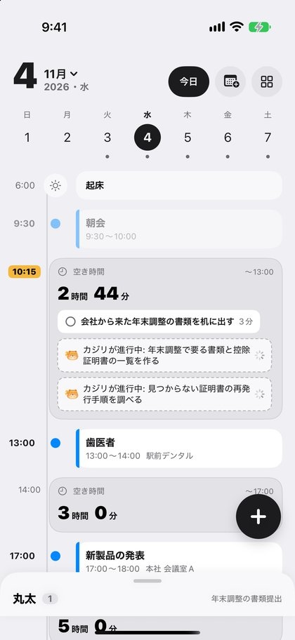
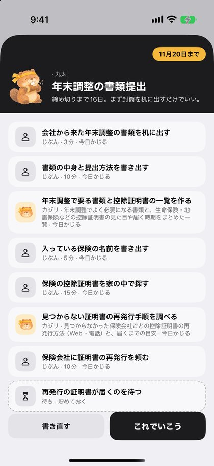
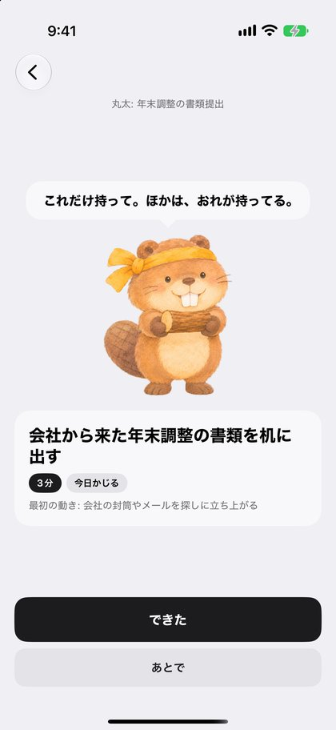
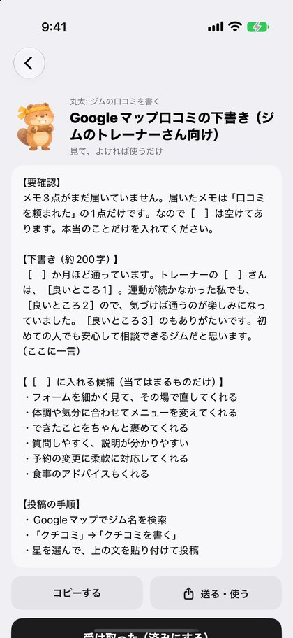
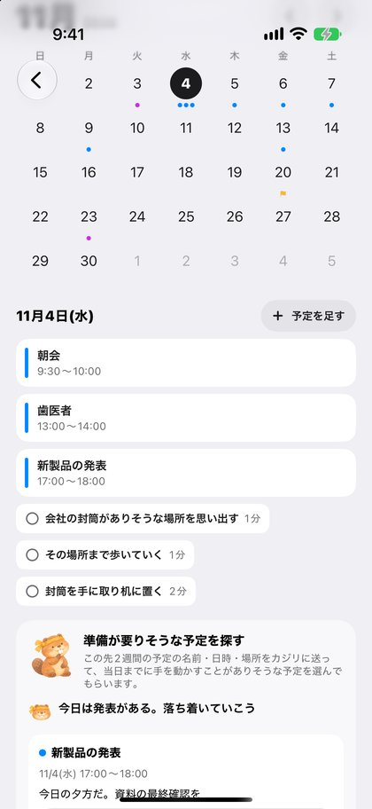
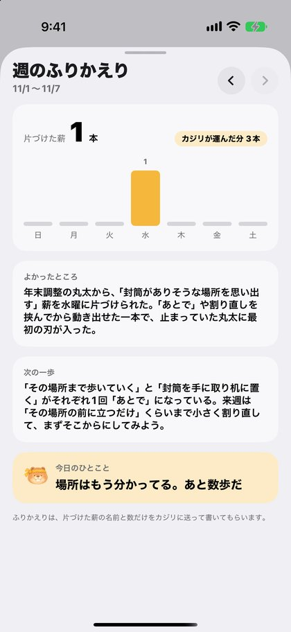

# Kajiri（カジリ）

**後回しにするのは、タスクが大きいから。** 小さくかじれば、手が動く。

Kajiri は、ADHD 気質の人のためのタスク管理とカレンダーのアプリです。
雑に投げた「気になってること」（丸太）を、ビーバーのカジリ（= Claude）が、すぐ手が動く 15 分以内の一歩（薪）にかじります。
薪ごとに「誰がやるか」と「急ぎか・大事か（4象限）」も決めます。カジリにできる下書きや調べものは、カジリが裏で同時に片づけます。

<p>



</p>
<p>



</p>

## なにができるか

| | |
|---|---|
| **丸太を投げる** | 「年末調整の書類、放置してる。締め切りは11月20日」くらいの雑なメモでいい。カジリが、丸太の名前・締め切り・終わるとうれしいこと・やる順の薪に分けます |
| **誰がやるか** | 薪ごとに「じぶん／カジリ／仲間に頼む／待ち」を決めます。調べもの・返信の下書き・一覧づくりはカジリの番になり、Web で調べながら裏で同時に進めます |
| **4象限** | 薪を「今日かじる／冬に備えて貯める／仲間に運んでもらう／川に流す」に置き分けます |
| **今日の薪は3本まで** | 全部を見せると固まるので、自分の番の薪から最大3本だけ。同じ丸太では1本ずつ順番に出します |
| **この1本だけ** | 押すと、その1本と最初の体の動きだけを見せます。見積もりと実際にかかった時間を残し、次に分けるときの見積もりに使います |
| **あとで** | 理由で直し方を変えます。まだ大きい → カジリがもっと小さく割り直す／いまじゃない → 明日また出す／頼みたい → 仲間の番へ／やらなくていい → 川に流す |
| **カレンダー** | iPhone に入れてある Google・iCloud・Outlook の予定をまとめて読み、1日の線に並べます。今日の薪は、予定のすき間（空き時間）の入る所に置きます。月の表示・予定を足す・直すもできるので、普通のカレンダーとしても使えます |
| **予定から準備をかじる** | 「新製品の発表」「引っ越し」のような予定から、準備を丸太として投げられます。この先2週間の予定から、準備が要りそうなものをカジリに探してもらうこともできます |
| **週のふりかえり** | 片づけた薪の数と曜日ごとの棒、カジリが書く【よかったところ】【次の一歩】【今日のひとこと】 |
| **通知** | 朝の1本目、締め切りの前の日の夜、月曜の朝のふりかえり。何かあるときだけ、次の1回ずつ入れます |
| **Siri・アクションボタン** | 「Kajiriに投げる」で、メモを入れた投げるシートを開きます |

## Claude の使いどころ

アプリから Anthropic の API は呼びません。すべて Firebase Functions の中継サーバ（`functions/`）を通します。中継サーバは App Check で、本物の Kajiri アプリからの呼び出しだけを受け付けます。

| 関数 | すること | 作り |
|---|---|---|
| `kajiriDecompose` | メモ → 丸太と薪 | Structured Outputs（JSON Schema）で形を固定。本人の「見積もりの何倍かかるか」を渡して、分数を見込ませる |
| `kajiriResplit` | 「あとで」にした薪 → 2〜4本のもっと小さい薪 | 同上。最初の1本は2分以内 |
| `kajiriWork` | カジリの番の薪（下書き・調べもの・一覧） | Web 検索ツール（`web_search_20260209`）で確かめてから書く。人に送る文は「本当のことか・きつくないか・約束できないことを約束していないか」を確かめ、本人が一言足せる行を残す |
| `kajiriPrep` | この先2週間の予定 → 準備が要りそうな予定 | 予定の名前・日時・場所だけを送る。届いていない予定の id は捨てる |
| `kajiriWeekly` | 1週間の記録 → よかったところ・次の一歩・今日のひとこと | 片づけた薪の名前と数だけを送る |

- モデルは `claude-opus-5-5`。`fallbacks: "default"` で、安全の判定で断られたときは別のモデルでやり直します
- カジリの口調は「落ち着いた職人の相棒」。褒めちぎらない・責めない・急かさない・命令しない。期限は圧力ではなく情報として伝えます（`functions/src/prompts.ts`）
- 中継サーバは、受け取ったタスクの中身を保存しません。ログにも書きません

## 何がどこに残るか

- 丸太と薪: iPhone の中だけ（SwiftData）
- 予定: iPhone のカレンダーのまま。Kajiri には写しません
- カジリに送るもの: 投げたメモ、薪の名前、（押したときだけ）予定の名前・日時・場所、（押したときだけ）1週間の薪の名前と数

## 構成

```
ios/        SwiftUI + SwiftData + EventKit（XcodeGen の project.yml から生成）。iOS 26、Swift 6
functions/  Firebase Functions（TypeScript）。公式 SDK @anthropic-ai/sdk で Claude API を呼ぶ
scripts/    秘密が入っていないかを調べるフック
```

iOS は MVVM + UseCase。1日の線の組み方（`DayPlanner`）、今日の薪の選び方（`TodayPicker`）、通知の決め方（`NotificationPlanner`）は、画面から切り離して単体テストしています。

## 動かし方

### 中継サーバ

```bash
cd functions
npm install
npm test
firebase functions:secrets:set ANTHROPIC_API_KEY   # Anthropic の API キー（Secret Manager にだけ置く）
npm run deploy
```

### iOS

```bash
cd ios
cp Config/Local.example.xcconfig Config/Local.xcconfig   # DEVELOPMENT_TEAM を書く
# Firebase コンソールから GoogleService-Info.plist を落として ios/Kajiri/ に置く
xcodegen generate
open Kajiri.xcodeproj
```

シミュレータでは App Check のデバッグプロバイダを使います。起動するとコンソールにデバッグトークンが出るので、Firebase コンソールの App Check に登録してください。

DEBUG ビルドだけの起動引数（確かめる・デモを撮るとき用）:

- `-seedDemo`: シミュレータのカレンダーに見本の予定を入れる
- `-demoHour 10`: 今日の 10:15 から時計を進める（夜中でも日中の画面を確かめるため）
- `-demoThrow "メモ"`: メモを入れた投げるシートを開く

## つくった人

Built with Claude: Japan 2026 の作品です。カジリの絵は ChatGPT の画像生成で作った自作です。
